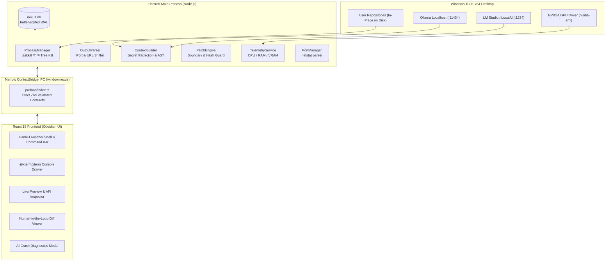

# NEXUS LAUNCHER

> **The Sovereign Desktop Project Launcher, Execution Engine & Local-First AI Command Center for Windows 10/11 (x64)**

Nexus Launcher is a specialized developer command center built from the ground up for Windows engineers, full-stack developers, and AI/ML practitioners. Engineered with **Electron 33**, **React 18**, **TypeScript Strict Mode**, **Tailwind CSS**, and **better-sqlite3**, Nexus delivers the immersion of a AAA game-launcher combined with rigorous OS-level process management and private, local-first LLM diagnostics.

---

## Architecture Overview



---

## Core Philosophy & Non-Negotiables

1. **Leave Projects Where They Live on Disk:** Nexus never moves, copies, or injects hidden metadata into user repositories. Projects are inspected and launched strictly in-place.
2. **Strict Security Boundaries:**
   - `contextIsolation: true`, `nodeIntegration: false`, `sandbox: false` in preload strictly for narrow bridge methods.
   - Zero raw `ipcRenderer` or `child_process` exposure to renderer.
   - All IPC parameters validated with strict **Zod** schemas.
   - Path traversal prevention: Every file access and patch operation validates that the target path resolves strictly within the project root (`..` and symlink escapes are immediately rejected).
3. **100% Offline AI Privacy:** Crash diagnostics and code repairs communicate strictly over local loopback (`127.0.0.1`). Environment variables and API keys are scrubbed before prompt construction.
4. **Deterministic SQLite State:** SQLite singleton with Write-Ahead Logging (`WAL`), `synchronous = NORMAL`, foreign keys, and versioned migrations.

---

## Feature Tour

### 1. Smart Project Scanner & Python Venv Resolver
- **Automated Stack Detection:** Identifies Node (Next.js, Vite, React, Express, Remix), Python (FastAPI, Flask, Django, Streamlit, PyTorch), Rust, Go, and Docker stacks.
- **Isolated Interpreter Injection:** Automatically locates `.venv\Scripts\python.exe` or `venv\Scripts\python.exe` and prepends the virtual environment's `Scripts` directory to the child process `PATH`.
- **Git Inspector:** Safely reads `.git/HEAD` and runs non-blocking `git status --porcelain -b` to display current branch and dirty working-tree count.
- **Config & Schema Inspector:** Auto-detects and displays read-only syntax-highlighted previews of `schema.prisma`, `*.sql`, `docker-compose.yml`, `package.json`, `pyproject.toml`, and `.env` with secret masking.

### 2. Process Execution Engine & Windows Tree Kill
- Spawns launch profiles with custom working directories and merged environment variables.
- **Windows Process Tree Eradication:** Stops and restarts processes using `taskkill /pid <PID> /T /F` to eliminate orphaned child workers (such as Uvicorn reload workers or Vite Node sub-processes).
- **Compound Stacks:** Launches multi-service architectures (e.g. FastAPI Backend + Vite Frontend) simultaneously with synchronized logging.

### 3. Real-Time `xterm.js` Bottom Drawer & Interactive Shell
- Resizable bottom terminal drawer powered by `@xterm/xterm` and `@xterm/addon-fit`.
- Multi-tab management for active processes with ANSI color preservation.
- Status badges (`RUNNING`, `STOPPED`, `CRASHED`), PID indicators, restart, stop, copy logs, and clear console.
- **Interactive PowerShell Session:** Spawns an interactive shell inside the project root with bi-directional `stdin` keystroke streaming.

### 4. Antigravity-Style Live Side Window Preview
- Automatically slides open a collapsible right-hand drawer as soon as a launched server binds to a localhost port.
- **Web App / Swagger Live View:** Embedded sandboxed preview container with a mini browser bar (URL input, reload, `/docs` quick-switch for FastAPI Swagger UI, external browser launcher, and desktop vs. mobile 375px viewport toggle).
- **Embedded Frame Protection:** Strips `X-Frame-Options` and restrictive `Content-Security-Policy` headers for localhost requests, ensuring local servers load smoothly without frame blocking.
- **API Ping & Health Check Inspector:** Built-in zero-CORS API testing client for pure backend microservices (`GET /health`, `POST /api/...`) with round-trip latency measurement (ms), status codes, headers, and formatted JSON responses.

### 5. Local-First AI Provider Architecture & Crash Diagnostics
- Pluggable provider adapter interface supporting:
  - **Ollama Local API** (`http://127.0.0.1:11434`)
  - **LM Studio / OpenAI-Compatible Local Server** (`http://127.0.0.1:1234/v1`)
- **Bounded Context Builder:** Assembles a token-bounded context with project metadata, Python venv details, the last 150 lines of captured console logs, manifest snippets, and surrounding source code (±15 lines) extracted from parsed stack traces.
- **Secret Redaction Engine:** Automatically strips `.env` secrets, `sk-...` keys, `ghp_...` tokens, and Bearer authorizations before prompting the LLM.
- **One-Click Failure Diagnosis:** Displays a **"⚡ Diagnose Failure"** button on crashed processes to generate an instant root-cause analysis, file/line reference, and recommended resolution command.

### 6. Human-in-the-Loop Code Repair & SQLite Rollback
- Strict workflow: `Diagnose -> Propose -> Review -> Approve -> Apply -> Verify`.
- **Unified Diff Viewer:** Interactive view highlighting exact additions (`+`) and deletions (`-`) alongside the AI explanation.
- **Stale Overwrite Protection:** Compares file SHA-256 hash before applying edits.
- **SQLite Snapshot Backups:** Stores pre-patch backups in the `patch_records` table, enabling 1-click rollback at any time.
- **Rerun & Verify:** 1-click button to restart the project after applying a patch to verify resolution.

### 7. Hardware Telemetry & Port Manager Matrix
- **Hardware Telemetry Footer:** Polls system metrics every 3 seconds:
  - Windows CPU usage % and active core count.
  - System RAM used/total GB and percentage.
  - NVIDIA GPU & VRAM telemetry via `nvidia-smi` with standard fallback.
  - SQLite WAL status indicator.
- **Port Manager Matrix:** Parses Windows `netstat -ano -p tcp` to list all listening sockets (e.g. 3000, 5173, 8000, 8080), cross-references PIDs with Nexus projects, and provides 1-click stuck port termination.

---

## Local LLM Setup Guide

Nexus operates completely offline without third-party cloud API keys.

### Option A: Ollama (Recommended)
1. Download and install [Ollama for Windows](https://ollama.com/download/windows).
2. Pull your desired coding or general model:
   ```powershell
   ollama pull llama3:latest
   # or for coding:
   ollama pull qwen2.5-coder:7b
   ```
3. Start the Ollama server:
   ```powershell
   ollama serve
   ```
4. In Nexus Launcher, navigate to **AI Assistant**, select **Ollama**, and click **Test Ping**.

### Option B: LM Studio
1. Download and install [LM Studio](https://lmstudio.ai/).
2. Load any GGUF model (e.g. Meta-Llama-3-8B-Instruct or Qwen2.5-Coder).
3. Start the **Local Inference Server** on port `1234` (ensure Cross-Origin-Resource-Sharing is enabled).
4. In Nexus Launcher, navigate to **AI Assistant**, select **LM Studio**, and click **Test Ping**.

---

## Getting Started & Build Instructions

### Prerequisites
- Windows 10/11 (x64)
- Node.js 20+ (Node 24 LTS verified)
- Python 3.10+ (for Python projects)
- Git for Windows

### Installation
```powershell
# Clone the repository
git clone https://github.com/your-org/nexus-launcher.git
cd nexus-launcher

# Install dependencies (respecting native better-sqlite3 build)
npm install --ignore-scripts
npx electron-builder install-app-deps
```

### Development Mode
```powershell
# Start Electron app in development mode with HMR
npm run dev
```

### Running Test Suite
```powershell
# Execute Vitest unit test suite (Path validation, secret redaction, port sniffer, patch boundary)
npm test
```

### Type Checking & Production Build
```powershell
# Run strict TypeScript typecheck
npm run typecheck

# Build main, preload, and renderer production bundles
npm run build
```

### Packaging for Windows
```powershell
# Package NSIS installer and portable executable targets for Windows x64
npm run pack:win
```
The output installers and portable executables will be placed in the `dist/` directory:
- `dist/Nexus Launcher Setup 0.1.0.exe` (NSIS Installer)
- `dist/Nexus Launcher 0.1.0.exe` (Standalone Portable Executable)

---

## Database Architecture (`nexus.db`)

Stored in `%APPDATA%\nexus-launcher\nexus.db` (or `%APPDATA%\Electron\nexus.db` in development) with WAL mode enabled.

| Table | Purpose |
|---|---|
| `projects` | Registered project repositories, path, framework, tags, and venv pointers |
| `launch_profiles` | Launch commands, arguments, working directories, and `.env` settings |
| `process_history` | PIDs, start/end timestamps, exit codes, and error summaries |
| `patch_records` | Complete pre-patch file snapshots, SHA-256 hashes, unified diffs, and rollback state |
| `settings` | Persisted key-value JSON configurations (telemetry, AI endpoints, themes) |

---

## Keyboard Shortcuts

| Shortcut | Action |
|---|---|
| `Ctrl+K` | Focus Global Command Bar |
| `Ctrl+Enter` | Send API Ping in API Inspector |
| `Escape` | Dismiss Modals & Drawers / Blur Command Bar |

---

## License
MIT License. Built for sovereign desktop project management.
